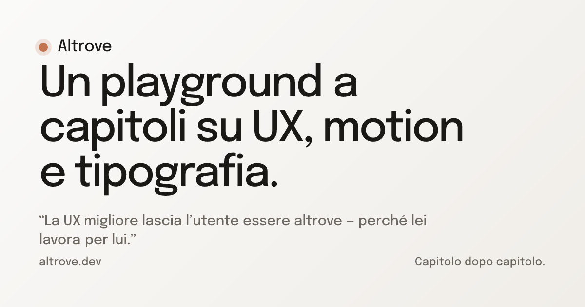

<div align="center">
  
</div>

<div align="center">

# Altrove

[](https://altrove.dev)
[](https://astro.build)
[](#licenza)
[](#licenza)

**[altrove.dev →](https://altrove.dev)**

</div>

> *Tutto quello che succede senza che l'utente se ne accorga è la vera potenza della UX.
> Nel frattempo, lui è altrove — con la mente.*

Un laboratorio personale a capitoli su **UX, motion design e tipografia**. Ogni capitolo è un esperimento finito: un pattern, una famiglia di componenti, una domanda con la sua risposta articolata. Il tutto annotato — perché *questa* curva, perché *questo* timing, quando un pattern è onesto e quando mente all'utente.

> *A personal playground, in chapters, about UX, motion, and typography. Each chapter is a finished study — a pattern, a family of components, a question with its articulated answer. Everything annotated: why this curve, why this timing, when a pattern is honest and when it lies.*

---

## I capitoli pubblicati

| # | Titolo · Title | Tema | Live |
|---|----------------|------|------|
| 01 | Anatomia di un bottone · Anatomy of a button | Il gesto più elementare dell'UI | [IT](https://altrove.dev/chapters/01-anatomia-di-un-bottone) · [EN](https://altrove.dev/en/chapters/01-anatomy-of-a-button) |
| 02 | L'arte dell'attesa · The art of waiting | Skeleton, optimistic UI, retry silenziosi | [IT](https://altrove.dev/chapters/02-l-arte-dell-attesa) · [EN](https://altrove.dev/en/chapters/02-the-art-of-waiting) |

I capitoli crescono lentamente. Un capitolo finito al 100% vale più di tre capitoli a metà. La mappa lunga (24 capitoli) è in [`CAPITOLI.md`](./CAPITOLI.md).

---

## Lo stack

| Tecnologia | Versione | Ruolo |
|------------|----------|-------|
| [Astro](https://astro.build) | 6 | Content Collections, View Transitions, islands |
| **CSS nativo** | — | `@layer`, OKLCH, `light-dark()`, `clamp()`, container queries |
| [Motion](https://motion.dev) | 12 | Spring physics, gesture, vanilla JS |
| **Epilogue Variable** | 5 | Sans variabile (100–900) per testo e titoli |
| **Inconsolata Variable** | 5 | Monospazio variabile per codice e dettagli |
| **MDX** | — | I capitoli sono documenti con componenti dentro |

Niente Tailwind, niente UI kit, niente starter. La palestra è scrivere CSS con `@layer`, custom properties e container queries.

---

## In locale

Servono Node ≥ 22.12.

```bash
git clone https://github.com/MatteoSchifano/altrove.git
cd altrove
npm install
npm run dev          # → http://localhost:4321
npm run build        # build di produzione in ./dist
npm run preview      # serve la build come la servirebbe il deploy
npm run og           # rigenera public/og-default.png
```

La home (l'*Atelier*) elenca i capitoli pubblicati; il toggle in alto a destra cambia lingua (IT ↔ EN) e tema (chiaro ↔ scuro ↔ sistema).

---

## Come è in produzione

Deployato su **Vercel** dal branch `main`. Sitemap, `robots.txt`, `llms.txt` e l'`og:image` di default sono generati a build-time. Analytics e Real User Monitoring dei Core Web Vitals via Vercel Web Analytics + Speed Insights.

Strategia robots.txt 2026: bloccati gli scraper di training (GPTBot, CCBot, Bytespider, Google-Extended), permessi i retrieval agent delle AI search (OAI-SearchBot, PerplexityBot, ClaudeBot, Applebot-Extended). Vogliamo essere citati, non essere materia prima.

---

## Struttura

```
src/
├── content/chapters/{it,en}/    # capitoli MDX, schema typed
├── components/
│   ├── ChapterCard.astro        # la card "magnetic" della home
│   ├── Demo.astro                # wrapper editoriale per le esplorazioni
│   ├── seo/JsonLd.astro          # JSON-LD generico Schema.org
│   ├── buttons/ · waiting/       # demo dei singoli capitoli
├── data/author.ts                # identità autore (Person schema)
├── layouts/
│   ├── Base.astro                # html shell + meta SEO completi
│   ├── Chapter.astro             # layout editoriale del capitolo
│   └── HomePage.astro            # l'Atelier
├── lib/                          # i18n, motion presets, readingTime
├── pages/                        # routing (IT root, EN /en/)
└── styles/                       # tokens · reset · typography · global
public/
├── og-default.png                # OG/Twitter card 1200×630
├── robots.txt · llms.txt         # SEO + AI signals
scripts/
└── generate-og.mjs               # satori + resvg → og-default.png
```

---

## Bilingue

Il progetto è in **italiano** (lingua madre del pensiero) e in **inglese** (lingua del web). Ogni capitolo esiste in entrambe le lingue, con la stessa struttura e lo stesso numero di demo. Il toggle `IT / EN` è sempre visibile.

L'italiano è il default sulla root; l'inglese vive sotto `/en/`. I feed RSS seguono la stessa convenzione: `/rss.xml` e `/en/rss.xml`.

---

## Filosofia

Le interfacce migliori sono invisibili. Non si celebrano, non chiedono attenzione. Lavorano in silenzio mentre l'utente pensa ad altro — uno skeleton screen che compare istantaneamente, un bottone che risponde prima della rete, un'immagine che ha già forma prima di esistere. Atti di rispetto verso il tempo e l'attenzione di chi guarda.

Il manifesto completo è in [`MISSION.md`](./MISSION.md). I principi di lavoro che guidano ogni capitolo:

- **Un capitolo alla volta, finito al 100% prima del prossimo.**
- **Scrivi prima la motivazione, poi il codice.**
- **`prefers-reduced-motion` non è opzionale.**
- **Resisti alle librerie.** La palestra è scrivere CSS con `@layer`, `clamp()`, custom properties, container queries.
- **Il motion si misura in millisecondi, non a sentimento.** Quattro preset (subtle / gentle / snappy / expressive), usati con coerenza.

---

## Roadmap

I prossimi 24 capitoli sono mappati in [`CAPITOLI.md`](./CAPITOLI.md), divisi in tre fasi:

- **Fase B · Componenti primari** — toggle, toast, menu, tab, scheda, divider.
- **Fase C · Pattern editoriali** — pagina lunga, griglia, citazione, nota a margine, indice, immagini in editoria.
- **Fase D · Pattern complessi** — drag & drop, ricerca, calendario, timeline, gesto, commiato.

L'ordine non è un contratto. È una mappa che riflette l'autore di oggi, non quello di un anno fa.

---

## Cosa **non** è

- Non è un design system da distribuire
- Non è un framework, una libreria, uno starter kit
- Non è una raccolta di "best practices" universali
- Non è fatto per impressionare — è fatto per capire

---

## Parlami

Altrove è un viaggio personale, ma non solitario.

- **Segnalazioni** di bug d'accessibilità o errori di traduzione: [apri un'issue](https://github.com/MatteoSchifano/altrove/issues)
- **Idee, critiche, conversazioni**: [@MatteoSchifano](https://github.com/MatteoSchifano)

Le pull request feature non sono accettate per scelta: il progetto vive nella selezione consapevole di chi scrive, non nella crescita per accumulazione.

---

## Licenza

Codice rilasciato sotto licenza **MIT**.
Testi dei capitoli (file `.mdx` in `src/content/`): **CC BY-NC 4.0** — condivisi liberamente, non per uso commerciale.

---

<div align="center">
<sub><em>Altrove è un viaggio lento. La destinazione non è importante quanto il fatto di essere in movimento.</em></sub>
</div>
